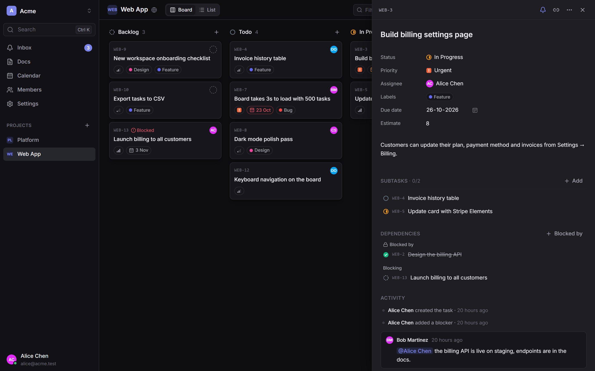
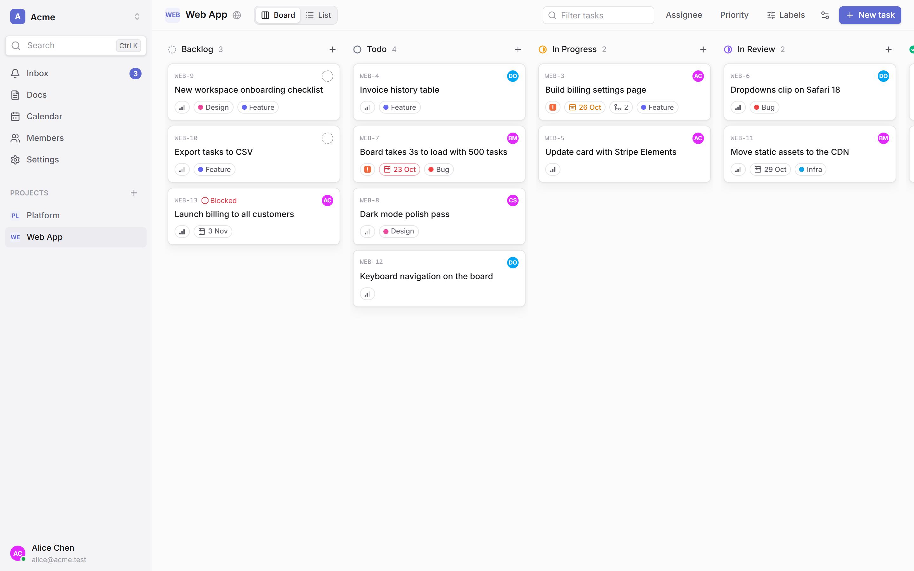
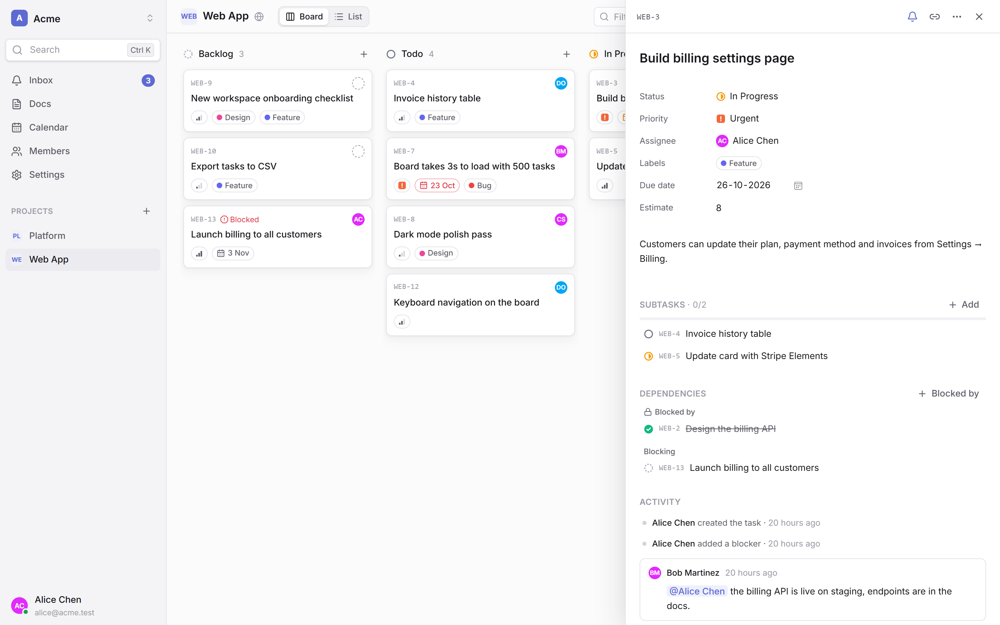
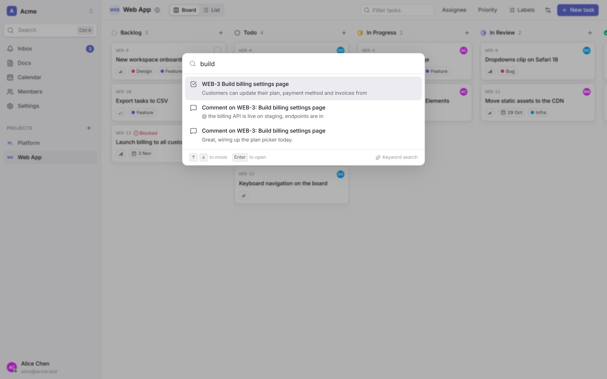
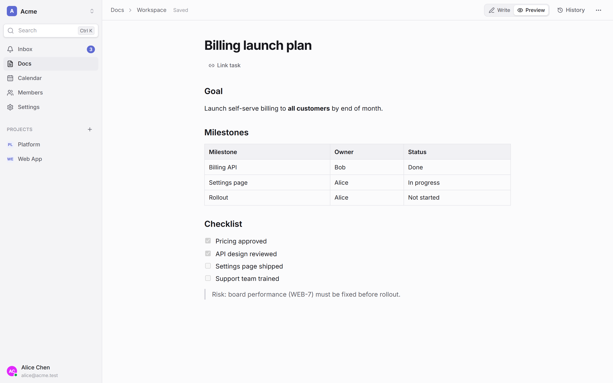
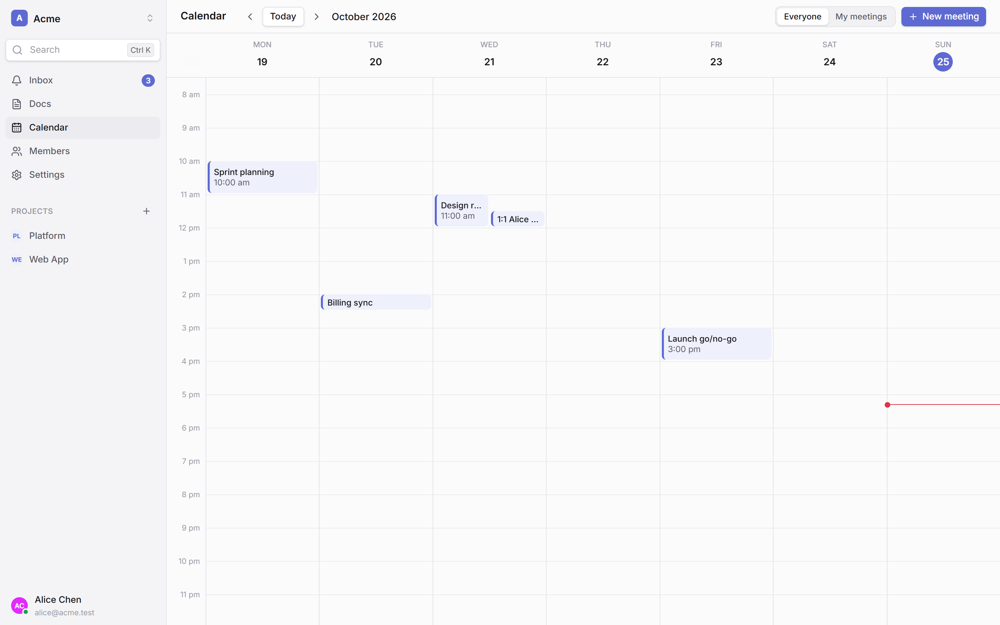
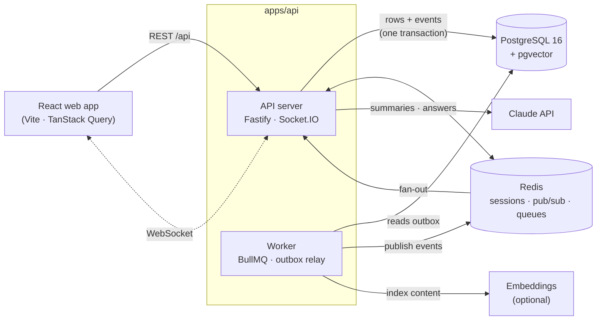

<div align="center">

# Team OS

**The all-in-one workspace for teams: projects, tasks, docs, meetings and an AI assistant that knows your work, in one fast, real-time app.**

[](#tech-stack)
[](#tech-stack)
[](#tech-stack)
[](#tech-stack)
[](#tech-stack)
[](#ai-assistant)
[](#testing)
[](LICENSE)

[Features](#features) · [AI assistant](#ai-assistant) · [Under the hood](#under-the-hood) · [Architecture](#architecture) · [Getting started](#getting-started) · [Roadmap](#roadmap)

<br />



</div>

<br />

## Why Team OS

Most teams juggle a tracker, a wiki, a calendar and a chat bot that knows none of them. Team OS puts them in one place, in the spirit of Linear, Jira and Lark, and builds them **properly**:

- **Live by default.** Every change appears instantly for everyone, across tabs, devices and server instances.
- **Permission-safe everywhere.** Every endpoint, socket room, search result and AI answer goes through the same access rules, enforced on the server.
- **AI that can act, safely.** The assistant summarizes, answers with citations and proposes changes, but nothing happens until you confirm, and it can never do more than you could.

<br />

## Features

<table>
  <tr>
    <td width="50%" valign="top">
      <h3>📋 Projects & tasks</h3>
      Kanban board with drag and drop, a filterable list view, and a rich task panel: statuses, priorities, labels, assignees, due dates, estimates, subtasks, comments with <code>@mentions</code> and a full activity log. Tasks get human keys like <code>WEB-42</code>.
    </td>
    <td width="50%" valign="top">
      
    </td>
  </tr>
  <tr>
    <td width="50%" valign="top">
      
    </td>
    <td width="50%" valign="top">
      <h3>🔗 Dependencies that mean something</h3>
      <i>Blocks / blocked by</i> links, even across projects. Cycles are rejected the moment you create them, a task can't be marked done while its blockers are still open (configurable per project), and the API returns the dependency graph and critical path.
    </td>
  </tr>
  <tr>
    <td width="50%" valign="top">
      <h3>🔎 Instant search, ⌘K</h3>
      One palette for everything. Hybrid search blends full-text and semantic (pgvector) results with Reciprocal Rank Fusion, with highlighted snippets. Access rules are applied <b>inside the SQL query</b>, so results you can't open are never returned.
    </td>
    <td width="50%" valign="top">
      
    </td>
  </tr>
  <tr>
    <td width="50%" valign="top">
      
    </td>
    <td width="50%" valign="top">
      <h3>📝 Docs</h3>
      Markdown docs for the workspace or a project, with tables, checklists and code. They autosave, keep version history you can restore, link to tasks, and detect conflicting edits instead of silently overwriting them.
    </td>
  </tr>
  <tr>
    <td width="50%" valign="top">
      <h3>📅 Calendar & meetings</h3>
      A week calendar with attendees and RSVPs. Each meeting gets a notes doc, linked tasks, and an AI button that turns its action items into real tasks.
    </td>
    <td width="50%" valign="top">
      
    </td>
  </tr>
</table>

**And more:** a real-time notifications inbox (assigned, mentioned, status changes, due soon, blocker resolved) with per-user preferences and an email digest · presence avatars showing who's viewing a task · workspace invites with expiring links · Google and GitHub sign-in · light and dark themes · a responsive layout for mobile.

<br />

## AI assistant

Built on the **Claude API**, and designed to be useful without being trusted blindly.

|                          |                                                                                                                                                                                                                                 |
| ------------------------ | ------------------------------------------------------------------------------------------------------------------------------------------------------------------------------------------------------------------------------- |
| ✨ **Summaries**         | One click summarizes a task thread, writes a project status update (overdue, blocked, recently moved), recaps a meeting or condenses a doc. Responses stream in as they're written and are cached until the content changes.    |
| 💬 **Ask the workspace** | Ask a question in ⌘K and get an answer drawn only from content **you** can access, with numbered citations that link to their sources.                                                                                          |
| 🪄 **AI actions**        | _"Create tasks for the launch checklist and assign the copy to Dana, due Friday."_ The AI proposes concrete actions, you review and confirm them, and the server carries them out through the normal API with your permissions. |
| 🗒️ **Notes → tasks**     | Turns the action items in meeting notes or a doc into tasks, with owners and due dates.                                                                                                                                         |

**Guardrails, by design:**

- **Permission-checked twice.** Proposed actions are checked against your permissions when they're shown, and again when they run. The AI can't see projects you can't see, assign people who lack access, or edit tasks you can only view.
- **Idempotent.** Confirming twice, or a retried request, never applies the actions twice.
- **Audited.** Every proposal, what you confirmed and what happened is recorded.
- **Optional.** Without an API key the AI features simply hide themselves.

<br />

## Under the hood

Team OS is built like a production system, not a demo:

- **Transactional outbox.** Every state change writes its event in the _same database transaction_, with a gap-free sequence number per workspace. A single elected worker publishes events through Redis to every API instance, so updates are never lost or duplicated, even if a server crashes mid-request.
- **Lossless real-time.** Socket.IO with the Redis adapter scales across instances. Clients that disconnect catch up with `GET /workspaces/:id/events?after=<seq>` and resume exactly where they left off. A user whose access is revoked is disconnected and has to re-authorize.
- **Optimistic concurrency.** Every task and doc carries a `version`, so conflicting edits return `409 Conflict` instead of silently overwriting each other.
- **Background jobs done right.** Notifications, search indexing, AI work and email digests run in BullMQ workers, never in the request path. Jobs retry with backoff, handlers are idempotent, and jobs that fail every retry land in a dead-letter queue.
- **Event-driven search indexing.** Changes trigger debounced re-index jobs, and unchanged content is skipped by content hash. Embeddings are pluggable (Voyage AI), and search falls back to keyword-only without them.
- **Clean architecture.** Each backend module is split into `domain → application → infrastructure → http` layers, with the dependency direction enforced by ESLint. Use cases depend on interfaces and are unit-tested with in-memory repositories.
- **Security baked in.** Zod validation on every request, CSRF protection, per-user rate limits (with tighter limits on AI), HTTP-only server-side sessions in Redis, and secrets only from environment variables.

<br />

## Architecture



**How a change travels:** a request is validated with Zod, checked by the central permission rules, and handled by a use case. That use case writes the change **and** its event in one transaction. The outbox relay then publishes the event to every API instance, which pushes it to authorized socket rooms, and enqueues it for background reactions such as notifications and search indexing.

<br />

## Tech stack

| Layer        | Technology                                                                                 |
| ------------ | ------------------------------------------------------------------------------------------ |
| **Frontend** | React 19, Vite, TypeScript, TanStack Query, Tailwind CSS, Radix UI, React Router           |
| **Backend**  | Node.js 22+, Fastify, Zod, Socket.IO (Redis adapter), BullMQ                               |
| **Data**     | PostgreSQL 16 + pgvector, Drizzle ORM & migrations, Redis 7                                |
| **AI**       | Claude API (Anthropic SDK, streaming, structured outputs), Voyage AI embeddings (optional) |
| **Auth**     | OAuth 2.0 with Google & GitHub via `arctic`, server-side sessions                          |
| **Quality**  | TypeScript strict, ESLint (architecture boundaries), Prettier, Vitest                      |
| **Tooling**  | npm workspaces monorepo, Docker Compose                                                    |

<br />

## Getting started

**Prerequisites:** Node.js 22+ and Docker.

```sh
git clone https://github.com/jithusj17/team-os.git
cd team-os

cp .env.example .env    # works out of the box for local development
docker compose up -d    # PostgreSQL + Redis
npm install
npm run db:migrate
npm run seed            # optional: a demo workspace with projects, tasks, docs and meetings
npm run dev             # API, worker and web app
```

Open **http://localhost:5173** and sign in with the email option as `alice@acme.test` to explore the demo workspace. Open a second window as `bob@acme.test` to watch changes appear live.

**Optional integrations** (set in `.env`):

| Variable                                            | Enables                                        |
| --------------------------------------------------- | ---------------------------------------------- |
| `ANTHROPIC_API_KEY`                                 | AI summaries, Ask the workspace and AI actions |
| `EMBEDDINGS_PROVIDER=voyage` + `VOYAGE_API_KEY`     | Semantic search (then run `npm run reindex`)   |
| `GOOGLE_CLIENT_ID` / `GITHUB_CLIENT_ID` (+ secrets) | Real OAuth sign-in                             |

### Scripts

| Command                                      | What it does                                                |
| -------------------------------------------- | ----------------------------------------------------------- |
| `npm run dev`                                | Runs the API server, background worker and web app together |
| `npm test`                                   | Runs all unit and integration tests                         |
| `npm run lint` / `npm run typecheck`         | Static checks across the monorepo                           |
| `npm run db:migrate` / `npm run db:generate` | Applies or generates Drizzle migrations                     |
| `npm run seed`                               | Creates the demo workspace                                  |
| `npm run reindex`                            | Rebuilds the search index                                   |

<br />

## Project structure

```text
team-os/
├── apps/
│   ├── api/                 # Backend: one codebase, two entry points
│   │   ├── src/
│   │   │   ├── server.ts    # HTTP + WebSocket server
│   │   │   ├── worker.ts    # Background jobs + outbox relay
│   │   │   ├── container.ts # Composition root (wires implementations)
│   │   │   └── modules/     # identity, workspaces, projects, tasks, docs,
│   │   │                    # meetings, notifications, realtime, search, ai
│   │   │                    #   └── domain / application / infrastructure / http
│   │   ├── drizzle/         # SQL migrations
│   │   └── test/            # Integration tests (real Postgres + Redis) and unit tests
│   └── web/                 # React app: features/, components/ui/, lib/
├── packages/
│   └── shared/              # Zod schemas, types and permission rules shared by API and web
└── docker-compose.yml       # PostgreSQL (pgvector) + Redis
```

<br />

## Testing

More than **250 tests**, run with `npm test`:

- **Integration tests** run against real PostgreSQL and Redis. They cover every role's access, dependency cycles and blocked transitions, real-time delivery across instances, notification fan-out and retries, search permission filtering, and AI action validation, permission denial and idempotency.
- **Unit tests** cover domain rules (critical path, fractional ordering, search ranking, name matching) and use cases with in-memory repositories.

<br />

## Roadmap

- [x] Foundation: monorepo, Fastify, Drizzle, health checks, structured logging
- [x] Auth & workspaces: OAuth, sessions, roles, invites, rate limiting, CSRF
- [x] Projects & tasks: statuses, labels, comments, activity, filtering, optimistic concurrency
- [x] Task dependencies: cycle detection, blocked transitions, critical path
- [x] Real-time collaboration: transactional outbox, Socket.IO, presence, resync
- [x] Notifications & background jobs: BullMQ, retries, dead-letter queue, email digests
- [x] Production web app: design system, light/dark themes, board, list, task panel
- [x] Docs, calendar & meetings
- [x] Hybrid search with permission-aware indexing
- [x] AI: streamed summaries, cited Q&A, confirmed actions, notes → tasks
- [ ] Hardening & deploy: load testing, security review, metrics, Docker images, CI/CD

<br />

## License

Released under the [MIT License](LICENSE). You're free to use, modify and distribute this code, including commercially, as long as the copyright notice is kept.

<br />

<div align="center">

Built by **[Jithu SJ](https://github.com/jithusj17)**

If you find this project interesting, consider giving it a ⭐

</div>
